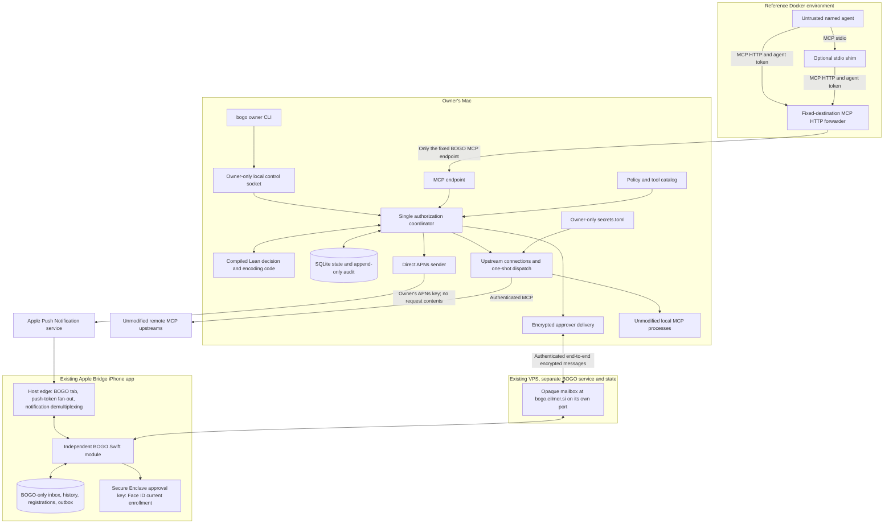

# BOGO: Architecture

Status: 2026-11-14. Built from SPEC.md.

## 0. The shape

BOGO is one owner-operated Rust service on the Mac, with an ordinary MCP interface toward named agents and private MCP connections toward unmodified upstreams. A small, executable Lean 4 state machine owns authorization and the canonical approval-request encoding; Rust owns transport, cryptographic verification, durable storage and effect delivery, but cannot independently authorize a tool call. The iPhone approver is a self-contained Swift package embedded as the BOGO tab in Apple Bridge, with its own registration, Secure Enclave approval keys, inbox, history and encrypted connection to BOGO’s separate relay. The Mac sends APNs notifications directly. A transactional event journal couples authorization consumption to the audit record before any upstream send; uncertain upstream sends are never replayed. The reference Docker environment exposes only BOGO and contains no upstream credentials. This design preserves the specified scope while making three unavoidable boundaries explicit: an arbitrary upstream cannot participate in an atomic commit with BOGO; a silent client timeout cannot always be observed; and App Attest authenticates app-originated evidence rather than directly certifying another key’s biometric access-control flags.

## 1. Runtime picture



The forwarder is a restricted transport component, not an approval service and not a general HTTP proxy. The relay never handles upstream credentials, APNs credentials, decrypted requests or authorization decisions. The Apple Bridge Mac gateway, relay, registration and push path are absent from this picture and from BOGO’s dependencies.

## 2. Units

| Unit | Language | Owns | May depend on | Must never depend on |
|---|---|---|---|---|
| Domain and authorization kernel | Lean 4 | Request types, exact encoding, policy selection, state transitions, dispatch eligibility, proofs | Lean standard library; explicitly modeled cryptographic and environmental facts | MCP SDK, network, database, UI, Apple Bridge |
| Lean bridge | Small C ABI and Rust | Runtime initialization, bounded buffers, reference ownership, typed kernel calls | Compiled Lean library | A second authorization implementation |
| MCP edge and shim | Rust | Authentication, raw JSON capture, MCP lifecycle, cancellation, agent-facing outcomes | `rmcp`, HTTP runtime, coordinator interface | Upstream credentials, direct dispatch, approval signing |
| Catalog and policy loader | Rust | Upstream discovery, namespaces, schema augmentation, TOML decoding and resolved snapshots | MCP discovery interface, domain types | Agent-provided policy or identity claims |
| Authorization coordinator | Rust | Serialized security events, request lifecycle, durable kernel transitions, attempt accounting | Lean bridge, store, verifier, dispatch and delivery interfaces | UI summaries as authorization input; bypass calls to upstream SDK peers |
| Store and audit | Rust and SQL | Durable requests, registry history, consumption records, delivery outboxes, hash-chain verification | SQLite, canonical event codec, cryptographic primitives | Network authority, policy decisions |
| Upstream adapter | Rust | Local process supervision, remote authentication, raw argument serialization, one-shot sends, output filtering | `rmcp`, secret provider, committed dispatch object | Agent-selected endpoint URLs, phone summaries, approval-route internals |
| Registration and cryptographic verifier | Rust | Numeric-comparison exchange, App Attest validation, key bindings, signature verification | Apple trust anchors, cryptographic libraries, registry storage | Relay assertions of trust, software approval keys in normal BOGO |
| Approver delivery and APNs | Rust | Encrypted reliable delivery, settlement updates, direct push requests | Registry transport keys, outbox, HTTP client | Authorization policy, Apple Bridge Mac services |
| Relay | Rust | Routing, opaque mailbox persistence, transport acknowledgements | HTTP/WebSocket runtime, its own database and TLS service | Approval private keys, upstream or APNs credentials, BOGO decision kernel |
| BOGO iPhone module | Swift | Exact decoding and review, Face ID signing, registration, inbox/history/Macs, own storage and relay transport | Apple Security, CryptoKit, DeviceCheck, SwiftUI, UserNotifications | Apple Bridge `DeviceIdentity`, `PairingClient`, `PhoneJob`, approval storage or delivery logic |
| iPhone host edge | Swift | Tab mounting, push-token fan-out, notification demultiplexing, retirement of old approvals | BOGO module’s public facade; existing unrelated host capabilities | BOGO key internals or policy interpretation |
| Owner CLI and service launcher | Rust | Setup, lifecycle, registry commands, tool inspection, cancellation, log inspection/export/verification | Owner-only socket, configuration parser, read-only audit API | Agent HTTP authority, remote owner-control API |
| Reference sandbox | Container configuration and Rust forwarder | Network restriction and credential isolation | Docker networking; fixed BOGO endpoint | Docker socket inside agent, host home mounts, direct upstream or relay access |

These are module boundaries, not a fleet of independently deployed Mac services. One process can host all Mac units. Only upstream processes, the relay, the existing iPhone app and an optional shim run separately.

## 3.1 Exact requests and the executable Lean kernel

### Request representation

The authoritative request is a typed immutable value. It contains:

- Encoding version and BOGO installation identity.
- Stable upstream identity and exact upstream tool name, plus the exposed namespaced name.
- Exact argument tree, including whether the MCP `arguments` member was absent.
- Optional justification, distinguishing absent from present-but-empty.
- Display hints with explicit field paths, formats and currency information.
- Stable agent identity and owner-assigned agent name.
- Client-reported name, explicitly unverified.
- Server-issued session identity and service-generation identity.
- Unique random request nonce, creation time and optional expiry.
- The resolved policy snapshot identity, including eligible approver identities and registration generations, threshold, denial behavior, output filtering and execution mode.

Binding the policy snapshot and installation identity adds internal context to the specified request, not an additional approval feature. It prevents signatures from changing meaning across registrations, policy revisions or Macs. The phone can expose this context as request details; it never substitutes it for the required argument display.

Arguments have the following algebraic structure:

```text
Json = Null | Bool(value) | String(unicodeScalars)
     | Number(validJsonNumberLexeme)
     | Array(ordered Json values)
     | Object(sorted unique String × Json entries)
```

Object ordering uses a specified ordering of UTF-8 key bytes, not a locale. Duplicate decoded object keys are rejected before any ordinary map is constructed. Ill-formed UTF-8, invalid surrogate sequences, malformed numbers and unsupported structural depths or lengths are rejected, never repaired. Strings are not Unicode-normalized. Numbers retain every character of their valid JSON number token: `4700`, `4700.0`, `4.7e3`, exponent capitalization and signed zero remain distinct. Object member order and equivalent JSON string escapes are presentation syntax, not differences in this canonical request type.

Lean defines the versioned tagged, length-prefixed binary format. Each constructor has a distinct tag; lists and strings have unambiguous lengths; optional fields have presence tags; integer widths and byte order are fixed; decoding must consume the entire input. Length overflow and allocation limits return errors. The injectivity theorem is over valid canonical request values within the encoding’s representable domain, not over every spelling of a JSON document. A decoder-left-inverse theorem supports the injectivity proof.

Rust does not supply a competing production request encoder. It passes a validated lexical tree through the Lean ABI and stores the bytes Lean returns. Swift has a strict decoder and can re-encode for canonicality checks; the bytes signed are still the original received bytes. Lean-generated vectors are published with the protocol, including distinct numeric lexemes and invalid encodings. This is a cross-language interface artifact, not an alternative definition of the format.

### Kernel interface and transitions

```text
encodeRequest : ValidRequest → EncodedRequest
step          : State × Event × TrustedFacts → Result (State × Effects)
checkDispatch : State × RequestId × TrustedFacts → RejectReason | DispatchDecision
```

`TrustedFacts` contains verified signature facts tied to particular keys and message bytes, trusted time observations, observed connection state, and transport readiness. It is not populated from booleans in agent or relay messages. Rust’s verifier can construct evidence objects only after validation; the FFI converts those into the kernel’s explicitly assumed facts.

The kernel handles authenticated agent admission, effective per-agent policy, request creation, response collection, revocation, pause, session end, optional expiry, cancellation, readiness and consumption. Cryptographic parsing remains outside; the rule for counting a verified response remains inside.

```text
Pending → Ready → DispatchCommitted → Completed
   │         │              └──────→ OutcomeUnknown
   ├─────────┴──────────────→ Ended
   └───────────────────────→ Denied

Invalid admission → Rejected
```

`Ready` means the approval requirement is settled. No later decision changes that settled requirement. It is not an enduring permission: session end, expiry, agent revocation/pause, or loss of sufficient currently registered approval keys still prevents dispatch. In wait mode the coordinator attempts dispatch immediately. In pending-and-retry mode it waits for the matching retry. `DispatchCommitted` is irreversible for single-use accounting even if no upstream effect ultimately occurs.

For k-of-n, the kernel counts distinct stable approver identities with the exact registered key generation named by the request. Repeated signatures from one approver count once. With deny-veto enabled, a valid denial processed while the request is pending settles it as denied. With veto disabled, a denying approver does not contribute an approval; the request can continue while the threshold remains achievable. An impossible threshold ends without execution. A denial that arrives after settlement is recorded as late, not retroactively applied.

Revocation is checked again at dispatch. Re-registration produces a new identity/key generation and cannot make an old signature valid again. An agent pause or revocation ends its outstanding requests and forbids every subsequent agent request, including tool discovery, until the permitted owner action restores access.

### What is proved / What is assumed

The Lean development proves, for arbitrary event sequences and arbitrary adversarial agent messages:

- Every protected dispatch decision has enough distinct, eligible, currently registered approvals.
- Every counted approval refers to the exact request encoding, justification, agent, session, installation and policy context.
- A request’s authorization can be consumed at most once.
- No dispatch decision follows cancellation, denial, session end, relevant revocation, pause or expiry already represented in state.
- Any-of, k-of-n, optional denial veto and per-agent overrides obey their definitions.
- Duplicate, late, malformed or mismatched evidence cannot manufacture eligibility.
- Encoding is deterministic and injective on the defined domain.
- Every allow-path dispatch corresponds to an effective allow policy rather than a Rust fast-path exception.

The executable functions used in these statements are compiled by Lean to C and linked into BOGO. There is no Rust reimplementation hidden behind a proof of a model. The C wrapper is limited to byte buffers, initialization, error conversion and Lean object ownership; one dedicated coordinator thread owns the runtime and avoids cross-thread object sharing. Lean documents its C interoperability and ownership requirements in the [FFI reference](https://lean-lang.org/doc/reference/latest/Run-Time-Code/Foreign-Function-Interface/); the actual runtime ABI is visible in [Lean’s header](https://github.com/leanprover/lean4/blob/master/src/include/lean/lean.h).

Explicit assumptions are signature unforgeability, hash collision resistance, correct AEAD and randomness, faithful crypto-verifier results, approver verification and key-access enforcement, accurate transport/time observations, correct persistence and effect delivery, compiler/runtime/FFI correctness, uncompromised Mac and phone OS, sandbox isolation, upstream access controls, and accurate trusted app rendering. The proof does not establish provider behavior, biometric quality, human judgment, network delivery, or exactly-once external effects. The docs name these assumptions individually rather than presenting the proof as covering the whole stack.

## 3.2 MCP, identities, policy and upstream adapters

### Ordinary MCP without losing signed values

The Mac serves an authenticated HTTP endpoint. Every HTTP request is authenticated independently, including requests using an existing MCP session identifier. Agent tokens are randomly generated bearer credentials, printed when created and stored by BOGO as verifier hashes. The owner name comes only from the local registry. MCP `clientInfo`, headers and tool arguments cannot override it. Invalid and revoked tokens never create sessions. The owner-control interface is a separate permission-restricted Unix socket and is not exposed by the HTTP router.

The endpoint validates Host and Origin and binds to local interfaces needed by the Mac and reference forwarder, not an unrestricted public listener. The shim forwards raw JSON rather than decoding and reserializing tool arguments. Its diagnostic output goes to stderr, never MCP stdout.

The inspected [`rmcp` request type](https://docs.rs/rmcp/3.10.0/rmcp/model/struct.CallToolRequestParams.html) represents arguments as `Option<JsonObject>`. An ordinary SDK decode/encode path therefore cannot be assumed to preserve the spec’s number spelling or detect duplicate object keys. BOGO uses `rmcp` for protocol lifecycle, discovery and transport integration, with a narrow lossless boundary at `tools/call`:

1. Capture the raw message body before SDK deserialization.
2. Parse the JSON-RPC envelope with duplicate detection and retain the original argument token slices.
3. Construct the lexical argument tree from those slices, not from floating-point values.
4. Correlate the raw call to the SDK request using server-generated internal correlation, session identity and typed JSON-RPC ID. An agent cannot overwrite another call’s capture by reusing an ID.
5. Use the immutable Lean-approved tree when writing the upstream call. The writer emits original number tokens and decoded string values safely, with the BOGO justification removed.

`serde_json::RawValue` is useful for retaining raw spans, but it is not itself a duplicate-key validator. Its [source-backed documentation](https://docs.rs/serde_json/1.0.154/serde_json/value/struct.RawValue.html) explicitly supports preserving original JSON syntax. The adapter must intercept both ingress and egress; enabling `arbitrary_precision` alone is not a sufficient security boundary. The `rmcp` [transport interface](https://github.com/modelcontextprotocol/rust-sdk/blob/main/crates/rmcp/src/transport.rs) supports custom transport integration. Any SDK change needed to carry raw payloads stays confined to this adapter and does not change upstream servers.

Unknown execution-affecting tool-call extensions must not be silently forwarded unsigned. Transport metadata such as request IDs and progress correlation is generated or mapped by BOGO. A negotiated continuation that changes execution inputs creates a new complete protected request; it cannot reuse an earlier approval merely because the SDK calls it a continuation.

### Sessions and protocol versions

BOGO’s session is an authorization boundary, not an agent name, TCP source port or JSON-RPC ID. A service restart creates a new service generation and invalidates all old sessions. Tokens can open new sessions, but cannot resurrect old approvals.

MCP currently has two materially different eras:

- In the [2025-11-25 transport](https://modelcontextprotocol.io/specification/2025-11-25/basic/transports), initialization establishes an MCP session, HTTP requests are multiplexed under it, and an SSE disconnection is not automatically a cancellation.
- In [2026-07-28](https://modelcontextprotocol.io/specification/2026-07-28/basic/transports/streamable-http.md), protocol-level sessions and the GET stream were removed. Closing a request’s response stream now cancels that request, as the [current cancellation rules](https://modelcontextprotocol.io/specification/2026-07-28/basic/patterns/cancellation.md) explicitly require.

The reference connection uses the BOGO shim’s process lifetime as an observable authorization session, with HTTP as its connection to the Mac service. EOF, shim exit, explicit cancellation and service-observed connection termination end the corresponding outstanding work. For initialization-era direct HTTP clients, bind the server-issued session to the authenticated agent and terminate it on explicit deletion or observed loss of its configured session connection. Wait-mode request cancellation also ends that request.

For modern direct HTTP wait-mode calls, the live request stream can be the short-lived authorization session: no authorization transfers to another HTTP request. Modern pending-and-retry cannot safely infer a shared session from an agent token or HTTP connection pool. It needs an explicitly defined BOGO session carrier or the shim. BOGO must reject unsupported combinations rather than silently broadening a token into an approval session. Supporting all standard clients with no additional configuration, indefinite request lifetime and cross-request retry identity simultaneously is an unresolved specification compatibility question.

No heartbeat, guessed idle timeout or concealed default expiry supplies missing lifetime semantics. A client that silently stops caring without closing or cancelling cannot be distinguished from one still waiting. The interface records observed lifecycle facts, and the promise must be stated in those terms.

### Discovery, names and policy

Each configured upstream has a stable internal identity and a human-readable alias. The alias may not contain `__`; tool names are looked up through a stored mapping, never by heuristically splitting an arbitrary string. Therefore `<upstream>__<tool>` is unambiguous even when the original tool name contains the delimiter. Invalid aliases and exposed-name collisions reject configuration or quarantine that catalog entry rather than selecting an arbitrary upstream.

Discovery follows pagination, caches full tool descriptors, and reacts to supported tool-list-change notifications. Tools remain independently routed to their original upstream connections. Descriptions and upstream input schemas remain intact except for the explicitly required justification augmentation. Denied tools are hidden per agent by default; showing them changes only discovery, never dispatch eligibility.

Precedence is explicit: a per-agent override replaces the tool’s policy and/or eligible approvers; remaining settings come from the tool record, then defaults. Compilation validates unique names, valid secret references, nonempty eligible sets for protected tools, and thresholds between one and the number of distinct eligible approvers. Invalid or ambiguous config prevents serving calls; it never silently falls back to allow. Policy is immutable for a service generation; restart applies edits and ends old sessions.

Unlisted tools use the configured default, initialized to approve. The spec also says newly discovered tools default to approve even if a configured default could be allow. Until that precedence is clarified, a newly encountered identity is conservatively approve rather than silently exposed as allow. A catalog/schema change while a protected request is pending ends that request: an approval is not reused against a newly defined tool contract.

The justification parameter is BOGO-owned and has a deterministic per-tool name chosen without colliding with explicit upstream properties. The catalog records that name. Validation removes only that parameter and then validates the remaining arguments against the original upstream schema. It never strips an upstream field just because its name resembles BOGO metadata.

For ordinary object schemas, the presented schema adds the optional justification field while preserving upstream field constraints and requiredness. Composition, references, `additionalProperties`, `patternProperties` and `unevaluatedProperties` require a schema-aware transformation; merely adding an outer `allOf` is incorrect for closed schemas. If a schema cannot be faithfully augmented, discovery reports the incompatibility and the tool cannot execute protected calls through a misleading schema. A universal fallback such as wrapping arguments or moving justification into `_meta` would change the specified interface and is a user question, not an undisclosed feature.

### Upstreams and credentials

Local upstreams run as supervised child processes with a minimal, explicitly constructed environment, stdin/stdout MCP pipes and sanitized operational logs. Remote upstreams use the configured URL and authentication on BOGO’s side. The agent never chooses a transport URL, launch command or authorization header. Remote redirects cannot carry credentials to a different authority without an explicit configured rule.

`~/.bogo` is owner-only; `secrets.toml` is an owner-owned regular file with owner-only read/write permissions and is opened with symlink and ownership checks. Secret references in `bogo.toml` resolve only inside BOGO. The credential-holding side includes the supervised upstream process that necessarily consumes its credential; no secret enters the agent environment, discovery response, relay message or request audit. Operational logging uses secret-aware types rather than `Debug` dumps of config, headers or child environments.

The MCP proxy does not expose arbitrary upstream resources, prompts, URLs, roots, sampling or elicitation as a bypass around tool policy. When an upstream tool requires a negotiated MCP capability, the adapter implements the minimal correctly scoped exchange or rejects it as unsupported. In particular, the filesystem upstream’s roots are owner-configured and cannot be replaced by agent-supplied roots. The official [filesystem source documentation](https://github.com/modelcontextprotocol/servers/tree/main/src/filesystem) states that client roots can replace command-line roots, making this a concrete security boundary rather than an optional optimization.

No upstream tool call is sent from catalog code, health checks or reconnect logic. Reconnect may retry initialization and discovery, but never an uncertain `tools/call`. Local subprocess retry behavior and provider-internal duplication are upstream assumptions; BOGO does not manufacture a second execution attempt.

## 3.3 Durable lifecycle, concurrency and one-shot dispatch

One coordinator serializes authorization-changing events. Parsing, cryptography, upstream I/O and notification delivery can run concurrently outside it. Cryptographic results carry the registration generation against which they were checked; the coordinator rejects stale results after revocation. Connections for different upstreams remain independent, and waiting on a phone never holds a database transaction or blocks unrelated allowed tools.

```text
submit(authenticatedSession, rawCall) → CallHandle
recordDecision(verifiedDecision)     → Accepted | Duplicate | Late | Invalid
endCall(callHandle, reason)          → Settlement
pauseAgent(verifiedControl)          → SettlementSet
dispatchReady(requestId)             → DispatchReceipt | Rejection
```

The store is SQLite on the Mac’s local filesystem. A single writer uses explicit transactions, foreign keys and durable synchronization. WAL permits log readers without blocking normal writes; `synchronous=FULL`, macOS full-fsync support and checkpoint synchronization are configured deliberately rather than relying on SQLite defaults. SQLite’s [atomic-commit account](https://www.sqlite.org/atomiccommit.html) and [synchronization pragmas](https://www.sqlite.org/pragma.html) explain the distinction between transaction atomicity and power-loss durability.

Request creation, attempt accounting, approval-response persistence, state transitions, delivery-outbox changes and audit appends are committed together where they describe one event. A reply claiming admission, denial or completion is sent only after the corresponding event is durable. A crash after receiving an undurable network message cannot preserve that message; the protocol retries until durable acknowledgement. This is the persistence boundary, not a claim of durable receipt at the instant a packet arrives.

### Dispatch boundary

1. Prepare the authenticated upstream connection and exact serialized request without sending it. Hold no authorization while connecting or refreshing credentials.
2. Ask Lean to check current policy, signatures, threshold, registration state, agent state, session state, cancellation and expiry.
3. In a transaction, record consumption and a dispatch intent, append its audit event, and remove pending delivery work. Commit durably.
4. Immediately before the first irreversible upstream write, perform the final freshness check through Lean against the current serialized coordinator state. No new network preparation occurs between that check and the send handoff. If it fails, retain consumption and record not-sent; never restore the approval.
5. Hand the prepared bytes to exactly one sender. The sender receives a private, non-cloneable dispatch object. There is no public `execute(tool, args)` method elsewhere.
6. Persist the upstream response, then apply output filtering and return it. Record completion independently from whether the agent remains connected to receive it.

Cancellation, revocation and pause are ordered against the final dispatch decision. Once bytes may have reached an upstream, BOGO cannot truthfully claim the action did not happen. Transport buffering and provider execution are outside the kernel’s linearization point; expiry means valid when BOGO authorizes forwarding, not guaranteed valid when a remote provider eventually performs its effect.

A crash after consumption but before or during send leaves an outcome-unknown or known-not-sent record. Recovery never replays it. This may sacrifice an approved action; it cannot spend its approval twice. A generic unmodified MCP upstream offers no atomic transaction spanning its side effect and BOGO’s journal. Exactly-once completion, automatic replay of uncertain sends and “silence always means nothing happened” cannot all be provided. The architecture preserves at-most-once forwarding and reports uncertainty rather than fabricating failure or success.

### Waiting, retries, duplicate grouping and flooding

Wait mode keeps the MCP response pending while the logical request is pending. The request has no default expiry. Phone delivery failure does not end it. A tool expiry, owner cancellation, denial, session end or observed call cancellation ends it before dispatch.

Pending-and-retry mode has a per-session exact-match index over upstream, tool, lexical arguments, justification and immutable policy context. A retry attaches to its existing request rather than minting another nonce. Approval settles the review; only a later identical retry can trigger dispatch. Concurrent identical retries contend for one consumption record. Changed arguments, justification or session cannot consume that approval and, if otherwise admissible, require a new approval request.

After consumption, further retries return a terminal already-consumed outcome or the stored result if the response contract permits replaying results; they never execute again. For an identical new business action in the same session, the protocol currently has no bit distinguishing “new call” from “retry.” The safe interpretation is one authorization per exact-match key for the session, with the ambiguity stated to the owner rather than resolved by sending twice.

Duplicate grouping is a view, not an authorization operation. In wait mode each original tool call keeps its own nonce, lifecycle and single-use requirement. The phone groups matching pending requests by agent, upstream, tool, arguments, justification, hints and policy context, and shows their count. Opening a group selects one concrete member for review and displays its session. Approve signs that member only. It does not approve the group, share one signature among members or silently coalesce multiple executions. Pending-and-retry retransmissions can increase an attempt count without creating extra execution authority.

The configured pending limit counts outstanding logical calls per agent, including ready-but-not-consumed requests. It is checked atomically before allocation or notification. Rejected excess attempts are audited without push. Ingress backpressure and bounded parser work keep a flood from turning the audit queue into unbounded memory; resource failure closes admission rather than skipping enforcement. No fixed rate or time target is introduced.

## 3.4 The iPhone module and host boundary

The module exposes a small facade:

```text
BOGOFeature.rootView()
BOGOFeature.updatePushToken(token, environment)
BOGOFeature.receiveNotification(payload, action)
BOGOFeature.sceneBecameActive()
```

Internally it separates `RequestCodec`, `ReviewModel`, `ApprovalKey`, `Registration`, `RelayTransport`, `InboxStore` and `DecisionOutbox`. The host neither constructs approval bytes nor accesses keys. A stand-in implements the module’s transport interface during phone-first construction; it is not a production approver route or a way to inject trusted state into BOGO.

The current host mounts `ShellApprovalsScreen` and an `ApprovalReview` sheet in [AppleBridgeApp.swift](/Users/johansardar/apple-bridge-iphone/ios/App/AppleBridgeApp.swift). Its [ShellModel.swift](/Users/johansardar/apple-bridge-iphone/ios/App/ShellModel.swift) defines the Approvals tab. These are replaced by the BOGO tab and module root. The existing app’s notification delegate in [PushDelivery.swift](/Users/johansardar/apple-bridge-iphone/ios/Delivery/PushDelivery.swift) currently routes approval notifications into the old implementation and forwards its token only into Apple Bridge identity storage. The revised host edge demultiplexes BOGO notification categories first and fans the APNs token out to two independent consumers. It does not pass BOGO traffic through `PushDelivery.drain`, `DeviceIdentity` or `PairingClient`.

BOGO startup, Add Mac and Inbox work without an Apple Bridge registration. Existing unrelated host features retain their behavior. The old approval capability is removed from [Capabilities.swift](/Users/johansardar/apple-bridge-iphone/ios/App/Capabilities.swift), its review UI is unmounted, outstanding old local notifications are removed, and no old cached approval can reach a signing path. Incoming `bridge.approval` jobs are ignored on the iPhone; no response is sent, so they expire on the unchanged Apple Bridge Mac.

Capture is a deliberate exception: both photo and audio requests return the host protocol’s explicit denied/rejected result immediately, regardless of capability toggle. They never invoke a camera, microphone or old approval view. This interception must occur before the general exception path, because the current delivery loop converts thrown errors to `indeterminate`. The existing capture dependency is visible in [CaptureCapability.swift](/Users/johansardar/apple-bridge-iphone/ios/Capabilities/Capture/CaptureCapability.swift), and dispatch selection in [CommandHandlers.swift](/Users/johansardar/apple-bridge-iphone/ios/Delivery/CommandHandlers.swift). This is an iPhone-only retirement, not a change to any Apple Bridge Mac component.

### Exact review

The BOGO inbox persists immutable signed-request bytes and validated decoding results. The review view gets only this object, not a second server-generated summary. Unknown versions or formats are non-approvable.

“Will execute (exact)” displays the upstream, tool, every argument and the owner-assigned agent name. The complete structural tree remains available even with highlights. Raw number lexemes remain visible alongside formatted values, preserving the distinction between `4700` and `4700.0`. String rendering makes control characters, direction overrides and significant whitespace inspectable; text is never interpreted as HTML, Markdown commands or an instruction to change the interface. Length is handled by navigation and scrolling, not silent truncation of the signed action.

Currency formatting operates on exact decimal text and integer scales, not binary floating point. `usd_cents` identifies USD explicitly and divides an exact valid value by the required scale. Invalid or incompatible hints display the raw field with an error rather than inventing a rounded amount. Every highlighted value resolves through a signed structural path into the signed arguments. No display amount is taken from the justification, tool description or a separately supplied summary.

“Agent’s reason (unverified)” displays justification, client-reported name, session tag and mismatch warnings. A small deterministic parser recognizes explicit monetary mentions, including `$47`, `47 USD` and `47 dollars`; it compares currency-and-value pairs against all successfully formatted signed currency fields. It ignores ordinary numbers such as times and flight numbers. Unsupported or ambiguous monetary syntax does not become a claim of correctness. A recognized amount absent from the actual currency values produces a warning. No monetary mention produces no warning. The exact real arguments remain visible regardless.

Approve is present only on the full review screen and is disabled for the specified short review delay, invalid decoding, ended requests, known missing freshness or unavailable Face ID. The delay starts when a particular request is presented and resets if its identity changes. Its concrete duration is not supplied by the spec and is not invented here. Deny can include a short note. Pausing an agent is a separate one-tap authenticated control action; it denies outstanding work and cannot unpause the agent.

Inbox shows pending entries and greys ended entries; History contains local decisions plus acknowledged final state; Macs lists registrations and supports Add Mac and remove. Selecting remove sends an authenticated self-revocation, ends local approval capability immediately and retains any necessary encrypted revocation outbox until acknowledged. Deleting a registration locally cannot be represented as confirmed Mac-side revocation while that Mac is unreachable.

### Keys and verification

Each Mac registration has a dedicated P-256 approval key generated inside the Secure Enclave, with `privateKeyUsage` and `biometryCurrentSet`, device-only storage and no passcode fallback. Require Face ID availability explicitly; do not silently substitute Touch ID. Each approval uses a fresh `LAContext` without a reuse window and performs the signing operation through the access-controlled key. A successful screen-level Face ID check followed by signing with an unrestricted key is not acceptable.

[Apple’s Secure Enclave documentation](https://developer.apple.com/documentation/security/protecting-keys-with-the-secure-enclave) states that the hardware creates nonexportable P-256 keys. [`biometryCurrentSet`](https://developer.apple.com/documentation/security/secaccesscontrolcreateflags/biometrycurrentset) invalidates access on enrollment changes. BOGO treats invalidated or missing keys as requiring re-registration and never automatically replaces them under the same trusted key identity.

The signed approval message is a domain-separated envelope containing the exact request bytes, decision type, approver identity and key generation. The cryptographic algorithm hashes this message as required by ECDSA; the application does not sign a summary or a JSON reserialization. The phone persists the resulting signed message before transmitting it. Retrying delivery sends the same decision, not another approval operation.

A distinct registered control key authenticates denials, pause, registration removal and transport-control messages without giving them approval authority. This allows Deny from a notification without a Face ID approval ceremony. The Mac’s accepted message types and verification keys are disjoint: a control signature cannot be converted into an approval signature by changing a field. Control and transport keys belong only to BOGO and are bound during registration.

## 3.5 Registration, App Attest and end-to-end transport

### Numeric comparison

`bogo approver add "Johan iPhone"` creates one active owner-initiated registration transaction. Add Mac on the phone obtains a candidate from BOGO’s registration rendezvous, not Apple Bridge discovery. Candidate names and relay routing are untrusted until the comparison succeeds. If several setups are advertising, the phone must select a candidate before displaying its comparison; no QR code, account secret or typed code is used.

The registration exchange has explicit roles, a transaction identifier, nonces, public-key encodings, protocol version and installation identity. It uses ephemeral authenticated-key-agreement confirmation with a commitment-before-reveal phase. One side commits to its ephemeral contribution and context before receiving the other’s contribution, reveals it only afterward, and both validate the commitment. The six displayed digits derive from the complete transcript and shared secret with a specified unbiased decimal extraction. A plain hash of two freely replaceable public keys is not sufficient: an attacker could grind candidates before choosing its last message.

The [Matrix SAS specification](https://spec.matrix.org/v1.16/client-server-api/#short-authentication-string-sas-verification) documents the commitment requirement and its ZRTP origin. BOGO uses that reviewed protocol structure with its own explicitly versioned transcript and P-256/HKDF primitives, not Matrix rooms, accounts or servers. The six-digit adaptation is a cryptographic integration risk and is not represented as already proved by the Lean authorization theorem. There is one displayed attempt per local transaction; retrying an aborted or mismatched attempt requires an explicit owner restart, not invisible relay-driven rerolls.

The Mac confirmation is authenticated under the established exchange key. Only after that confirmation does the phone request Face ID, create its approval key and sign registration confirmation. The final registration binds the newly generated approval public key, control/encryption keys, Mac identity, transaction transcript and one-time App Attest challenge. Thus a key created after numeric comparison is still cryptographically attached to the compared exchange. Neither side trusts a registration until both confirmations and the required attestation verification are durable. If a final acknowledgement is lost, the same transaction resumes idempotently; it does not create a second trusted approver.

### App Attest boundary

The phone generates a BOGO-specific App Attest key and supplies attestation over a fresh Mac challenge bound to the complete registration evidence. The Mac validates the CBOR structure; Apple certificate chain and pinned App Attest root; nonce extension; app identity; credential/public-key identity; expected counter; production/development environment; and any required platform-supported validation-category and app-version fields. It stores the evidence, extracted App Attest public key, challenge consumption and registration binding. Unsupported hardware, malformed certificates, untrusted environments and unavailable proof refuse registration, with retry possible; BOGO does not apply Apple’s optional graceful-bypass example.

The authoritative validation procedure is [Apple’s server validation documentation](https://developer.apple.com/documentation/devicecheck/validating-apps-that-connect-to-your-server). The attestation key and approval key are different keys. App Attest does not directly return a certificate saying that the arbitrary approval public key carries `biometryCurrentSet`. Instead, the attested genuine app’s registration code creates that key internally, reads its attributes, signs the bound registration with it after Face ID, and attests the resulting evidence. There is no API to supply an externally generated approval key to that code path.

This closes the modified-app substitution route under Apple’s app-integrity and uncompromised-OS assumptions. It does not constitute independent hardware attestation of the approval key’s ACL. The documentation and user decision must preserve that distinction. Where supported, accepted app-version evidence must exclude the old implementation with screen-only Face ID. Development attestation can support a separately identified development setup; normal registrations cannot silently accept it as production proof.

App Attest keys are not used as approval keys and are not substituted for Face ID. App reinstall, key loss, device migration or biometric-key invalidation requires a fresh registration. Revoking an approver invalidates its approval and control authority independently of other registrations. The old registration remains in the audit history.

### Encrypted messages

Registration establishes per-Mac/per-approver encryption context. P-256 ECDH and HKDF-SHA256 derive separate directional keys with installation, registration generation and protocol domains in the derivation. ChaCha20-Poly1305 protects each message; Swift CryptoKit and Rust implement the same standardized construction. Approval signatures remain independently verifiable inside the ciphertext.

An envelope authenticates protocol version, sender/recipient registration, direction, message kind, unique message identifier and nonce. Nonce counters are reserved durably before use and never reused under a key, including after a crash. Identical retransmissions reuse the stored ciphertext rather than re-encrypting altered plaintext under the same nonce. Re-registration creates fresh keys and a fresh nonce namespace.

Receivers authenticate before parsing contents, persist message acceptance and state transitions together, and acknowledge only durable acceptance. Duplicate message IDs are idempotent; conflicting bytes under the same ID are rejected. Out-of-order delivery does not discard still-needed older requests merely because a higher global sequence arrived. Per-request state versions prevent a replayed pending update from resurrecting an ended entry.

Request contents, justification, decisions, notes, agent identities and push-token updates travel inside encryption. Mailbox identifiers, ciphertext sizes, IP-level traffic and timing remain visible to the relay; cryptography does not hide that metadata. On reconnect, the phone reconciles its inbox against authenticated Mac state and receives ended markers as well as active requests. A relay acknowledgement is not evidence that the phone displayed or the owner decided anything.

## 3.6 Relay, notifications and durable delivery

The relay is a separate Rust executable with a separate service account, listening port and data directory on the existing VPS. It has no code-level or runtime dependency on Apple Bridge’s relay. The hostname is `bogo.eilmer.si`; its non-443 port is explicit in registration/bootstrap configuration and allowed by the VPS firewall. A valid public certificate covers the hostname regardless of port. Certificate renewal uses a DNS credential scoped to the required Cloudflare zone and kept outside relay application state.

“Relay holds no secrets” means no BOGO application secrets: no upstream credentials, APNs key, encryption keys or approval keys. Ordinary TLS termination still requires its own TLS private key. Mailbox access can be authenticated by public transport identities or verifier hashes without storing endpoint private keys. Compromising the relay can delay, delete, replay or reorder delivery but cannot authorize an action or decrypt a request.

```text
Relay.put(mailbox, messageId, opaqueBytes) → Stored
Relay.receive(mailbox, cursor)            → opaqueMessages
Relay.ack(mailbox, messageIds)            → Removed
```

The relay persists opaque messages for temporary disconnection. Endpoints remain authoritative: a Mac outbox retains every live request until application acknowledgement or settlement, and a phone outbox retains signed decisions until acknowledged. Relay state can be rebuilt by endpoint reconciliation. Delivery retries continue while the request remains live; no retry-count limit becomes an implicit expiry. Backoff and connection reuse affect resource consumption, not authorization lifetime.

The Mac APNs unit reads the owner’s existing provider key through the secret provider and sends HTTP/2 notifications directly. The payload contains a BOGO category, opaque request/installation routing and a generic alert, never arguments or justification. It requests time-sensitive presentation and offers only Deny. The default tap opens the full BOGO review; there is no Approve notification action. The host adds BOGO categories without overwriting unrelated host categories.

APNs is a hint to fetch authenticated state, not the queue or source of truth. [Apple documents APNs as best-effort](https://developer.apple.com/documentation/usernotifications/sending-notification-requests-to-apns): notifications may be throttled, reordered or omitted, and only one notification per bundle may be retained. The shared bundle token therefore does not provide independent durable notification queues for Apple Bridge and BOGO. Inbox reconciliation supplies correctness when a push disappears. The owner can disable time-sensitive notifications at the OS level; BOGO cannot promise delivery despite that.

A stale Deny notification is checked against the exact persisted request identity; it cannot deny a different request with a recycled display label. An offline denial is queued as a signed control decision. An offline approval is never treated as already authorized: known-ended or unverifiable current state disables approval, and the Mac always performs final freshness checks even after Face ID.

## 3.7 Output filtering and audit

### Output filtering

A filter is a deterministic, per-tool projection over the complete MCP result returned to the agent. Field selectors use structural paths; a bare configuration field name is compiled into an unambiguous selector. Actions are remove or redact. Structured content, protocol metadata and content blocks are considered together so a removed URL is not left in a duplicate text representation.

When an upstream embeds a JSON object inside a text block, the adapter can parse that representation losslessly and apply the same structural projection. Plain prose, binary content and arbitrary embedded documents do not admit reliable field-level redaction. If a configured field filter cannot be applied without releasing an unchecked duplicate representation, BOGO withholds that representation or rejects delivery of the filtered result rather than claiming the field was removed. It never retries the already executed tool to obtain a different result.

When no filtering is configured, the upstream’s actual result passes through without fabricated success. When filtering is configured, the response preserves valid MCP framing and explicitly indicates filtering where needed; an upstream output schema is not allowed to assert fields that the filtered response no longer contains. The catalog’s exposed output schema must reflect that projection or omit an optional output schema that cannot be honestly transformed.

No blanket semantic guarantee says every future bypass credential can be recognized in arbitrary upstream prose. The owner chooses filters, upstreams remain trusted to obey their contract, and the sandbox prevents direct use of any unintended network route. Secret-aware egress additionally prevents BOGO’s own known connection credentials from being reflected through errors or diagnostics.

### Append-only record

The authoritative audit is an append-only event table in the same database as execution state, not a second log file that can diverge during a crash. Its API only appends; database constraints reject application updates and deletes. Searchable indexes and materialized views are derived data. Export emits a deterministic stream containing event bytes, sequence numbers, previous hashes and current hashes.

Each entry is hashed as a domain-separated encoding of sequence, previous hash and event payload. Events include:

- Protected attempts, including malformed, denied-policy, paused-agent and flood-limit rejections that reach authenticated admission.
- Immutable requested action, justification, authenticated identity and policy snapshot.
- Request creation, ending, cancellation, expiry and settlement.
- Responding approver identity/key generation, decision, note and signed bytes.
- Registration, revocation and agent-state changes needed to interpret later events.
- Consumption, dispatch intent, known not-sent, completion and uncertain outcome.

The record includes argument values as specified. Credential values loaded from BOGO’s secret provider are excluded. Inputs that would require copying a known BOGO credential into a durable request are rejected at the secret boundary and recorded without reproducing the credential. Unparseable hostile input is represented safely as rejection evidence, never fed directly into terminal output.

`bogo log verify` walks the chain, checks canonical event encoding and sequence continuity, rebuilds registration history, verifies each signature against its exact signed bytes and registration generation, and distinguishes validity when received from eligibility when consumed. A later revocation does not make an earlier valid decision historically invalid. A response that was already revoked when received is logged as rejected evidence, not counted as a valid approval.

A hash chain detects alteration or removal inside a retained chain. It cannot, by itself, detect truncation to an earlier valid prefix or an attacker rewriting all local state. That requires a separately retained head, such as an owner-retained export; this architecture does not quietly add an external transparency service. A compromised Mac is outside the threat model. `verify` reports the last verified head and does not advertise stronger tamper evidence than the design provides.

If storage is full or the journal cannot commit, no new execution occurs. BOGO applies backpressure or refuses the connection; it cannot truthfully promise to record unlimited rejected packets while storage is unavailable. Already committed records remain the recovery source.

## 3.8 Owner commands, sandbox and the specified upstreams

The `bogo` executable provides setup, service start/stop, approver registration/list/revoke/re-register, agent add/list/revoke/pause/unpause, tool-policy inspection, pending-request cancellation, and log view/search/export/verify. Cancellation is an owner-only operation corresponding to the specified owner-cancel lifecycle, not another agent tool. Re-registration is the same authenticated Add Mac flow with a new key generation, never an overwrite of historical key evidence.

`bogo init` creates owner-only directories, a safe approve-by-default config, installation identity and the service configuration. `bogo start` validates configuration and durable state before accepting agents; the service is supervised by a macOS LaunchAgent so an unexpected exit restarts the service. Stop ends sessions, commits endings and stops new dispatch before closing transports. Policy edits take effect on restart; live reload is not needed.

The owner socket is authenticated by filesystem permissions and peer identity. It is not mounted into the sandbox and is not exposed on the relay. Log export and tool inspection do not disclose secret values.

### Reference isolation

Use a dedicated internal Docker network for the agent and a minimal fixed-destination HTTP forwarder. The forwarder also has the outward route needed to reach the fixed Mac BOGO endpoint. The agent cannot join the outward network, administer its network namespace or change the forwarder configuration. The forwarder accepts only BOGO’s MCP path and supported methods and forwards only to the configured BOGO authority; it supports neither CONNECT nor URL-selected routing nor arbitrary redirects.

The reference launcher installs default-deny rules in the agent network namespace before starting the untrusted agent: only the fixed forwarder address/port and necessary established traffic are permitted. Direct host-gateway traffic, Docker DNS forwarding, IPv6 egress, link-local routes and other private/public destinations are denied. The agent then runs unprivileged with capabilities dropped, no Docker socket, no host home mount and no writable access to its network controls. A Docker internal bridge alone is not treated as proof of isolation: [Docker’s bridge documentation](https://docs.docker.com/engine/network/drivers/bridge/) describes host reachability and default masquerading, and its [firewall documentation](https://docs.docker.com/engine/network/packet-filtering-firewalls/) explains that published-port routing can bypass assumptions about host firewall rules.

The only supplied credential is that named agent’s BOGO token. `~/.bogo`, Link authentication state, APNs material, service control sockets and upstream process files are absent from the container. The filesystem upstream is rooted in an owner-selected nonsecret directory, not the Mac home directory or BOGO state. A permitted filesystem read must not become an alternate credential-read path. Agent-controlled shell execution remains inside this sandbox; BOGO itself does not claim to gate non-MCP shell actions.

The spec-mandated bypass checker is a shipped executable run inside the reference container. Its contract is to exercise direct upstream/relay reachability, credential-file access and protected-tool calls without approval, and report whether any forbidden route succeeds. This is the specified sandbox artifact, not an added general testing framework. No fixed run length or count is imposed.

The network rule also prevents a conventional cloud-connected agent from reaching its model provider. The reference setup cannot silently allow arbitrary model API access without changing “no network access except to BOGO.” Whether inference runs outside the container or the spec permits another constrained route is a user decision.

### Stripe Link and filesystem

The payment upstream is the unmodified Link CLI in MCP mode, and the non-commerce upstream is the official filesystem server. Versions and executables are pinned in owner-controlled setup rather than fetched opportunistically each time a protected call is made. Tool names and schemas come from discovery, not the illustrative `create_payment_link` name in the config sketch.

The current [Link CLI source documentation](https://github.com/stripe/link-cli/blob/main/README.md) confirms `link-cli --mcp`, device-flow authentication, US/Canadian account availability, `LINK_ACCESS_TOKEN`/`LINK_REFRESH_TOKEN` credential injection and a custom authentication-file option. These permit BOGO to keep the persistent credential source in `secrets.toml` and supply credentials only to its private child. Refreshed tokens must return through the owner-side credential adapter and an atomic secret-file update; they must not silently migrate into the agent’s home or logs. If the unmodified CLI’s refresh mechanism cannot expose rotated tokens without its own writable auth file, the exact storage requirement needs resolution rather than claiming arbitrary CLI state is TOML.

The same source currently documents `--test` for testmode SpendRequests, while Link Pay Tokens do not support it and some checkout flows are live-only. Therefore a login flag alone is not evidence that every discovered Link tool is harmless. The reference payment flow must use actual supported testmode spend-request fields and returned test credentials; unsupported live-only paths are not executed as a demonstration. No regular Stripe MCP replacement is introduced.

A Link spend request is not necessarily a completed merchant charge: Link can require additional approval and produce payment credentials for later use. BOGO returns the real result of the approved MCP tool, not a fabricated “payment completed” result. Which Link tools to protect and which exact test-mode operation realizes the $47 scenario remain explicit owner choices.

## 4. Data flows

### 1. Payment approved

1. The agent authenticates with its connection token and calls the discovered namespaced Link tool in the chosen session, with exact testmode arguments and a justification.
2. The MCP edge captures raw arguments. Policy resolves to approve with the required approvers and signed display hints. Lean creates the encoded request; state, audit and delivery outboxes commit.
3. Each eligible approver receives encrypted bytes. The Mac independently sends a generic time-sensitive APNs notification.
4. Tapping the notification opens the complete request. The phone shows the exact amount as $47.00 and “Requested by Trip planner”; the justification remains unverified text.
5. After the review delay, Approve invokes Face ID and the Secure Enclave signs those bytes. The phone persists and transmits the signed decision.
6. The Mac verifies the signature, applies the Lean transition, checks freshness and registration at dispatch, consumes authorization durably and sends the exact stripped arguments once.
7. The upstream’s real result is persisted, filtered if configured and returned to the agent. The audit contains the exact request, approval evidence and dispatch/completion record. If Link requires a later step, that remains visible in the real result.

### 2. A lie in the justification

The signed amount is 50000 cents and the signed justification mentions $5. The exact review shows $500.00 and a mismatch warning. Deny with “wrong amount” creates an authenticated denial. The kernel settles without dispatch and the agent receives `The owner denied this action. wrong amount`. Relay delivery retries cannot change that settlement.

### 3. Changed arguments, changed justification, another session or replay

A changed lexical tree or justification yields different request bytes. Another session has a different binding even for identical arguments. Such a call cannot consume the existing approval; it needs its own approval or is rejected. Replayed decision messages are idempotent. A consumed request never creates another dispatch. Numeric spelling changes count as changes, not just numeric value changes.

### 4. Allowed tool

The authenticated call resolves to allow in the Lean policy logic. After ordinary input and session checks, it obtains an allow dispatch decision and runs without request fan-out, APNs or Face ID. Reused upstream connections and cached policy avoid work unrelated to the call. No notification or approval persistence is placed on this path merely to imitate a protected call.

### 5. Denied tool

The Researcher-specific policy omits the tool from that agent’s catalog. Calling the name anyway is rejected before upstream dispatch and recorded with the deny-policy reason. Discovery filtering is not the enforcement boundary.

### 6. No response, cancellation or expiry

The call waits without a default deadline. A supported client cancellation, shim EOF, observed session end or configured tool expiry is serialized into the kernel, committed and sent as settlement to approvers. If the call still has a usable response path, it receives `Approval was not received in time; the action was not performed.` The phone greys the request. A later signed response is logged as late and cannot run it. The not-performed text is used only when no upstream send could have occurred.

### 7. Phone offline

Mac state and outboxes survive the delivery interruption. The request remains pending while its call/session remains alive and no optional expiry passes. On reconnect, authenticated reconciliation delivers pending requests and endings; the phone may decide a still-live request. Neither an APNs failure nor a relay retry counter expires it.

### 8. Add Mac

The owner starts Add on the Mac and Add Mac on the phone. Commitment-based exchange produces matching six digits. Mac confirmation precedes the phone’s Face ID confirmation and approval-key creation. App Attest and signed key-binding evidence are verified before durable registration. Both sides acknowledge the same registration generation; the owner sees it in Macs and `bogo approver list`.

### 9. Add agent

The owner creates “Trip planner.” BOGO commits the stable identity and token verifier, then prints the connection token. The agent receives only that token. The next authenticated session uses the registry name in signed requests; an absent token is refused and client-supplied identity remains unverified.

### 10. Stolen phone and revocation

The locked phone cannot use the Face ID approval key. The Mac revoke command records revocation and invalidates pending approval eligibility. A signature received afterward is rejected, including one cryptographically valid under the former key. Other approvers remain independent. Revocation’s effect begins when the Mac commits it, not when an offline command is merely composed.

### 11. Face ID enrollment changes

The access-controlled approval key becomes unusable. No fallback key or passcode-only approval is offered. The phone marks the registration as requiring Add Mac again; old public-key history remains auditable. A new registration cannot revive earlier approvals.

### 12. Two approvers

The same exact request goes to both registered approvers. One response counts once regardless of duplicate transport delivery or repeated signatures. The second distinct valid approval reaches 2-of-2. A denial received while pending settles immediately with the default veto policy. Dispatch still rechecks both keys’ registration status and freshness.

### 13. Output filtering

The approved filesystem action executes once. Its result is persisted and projected through the configured field filter before any result bytes reach the agent. Duplicate representations are filtered together or withheld. Failure to filter yields an output-delivery error and an audit record, not a second tool execution.

### 14. Sandbox escape attempt

Direct Stripe API, relay and host-service connections fail at the reference namespace/network boundary. Credential paths are not mounted and are excluded from filesystem-upstream roots. Calls to BOGO without a valid token fail authentication; calls to protected tools with a token still need exact approval. The shipped bypass checker reports any route that violates these conditions.

### 15. Verify the record

The CLI reads the local audit without contacting upstreams. It verifies hashes and order, rebuilds registration/revocation history, checks signed request bytes and approval eligibility at consumption, and reports the verified head plus any corruption or uncertain dispatch. Search and export operate on the same authoritative events.

### 16. Flood and pause

Matching pending requests appear in one phone group with a count, but retain separate execution authority. The per-agent pending limit rejects additional requests silently with respect to notifications and durably logs the rejection. Pause sends a typed authenticated control message. The Mac denies pending requests and rejects every new request from that agent. Only the owner’s Mac command can unpause it.

### 17. Two upstreams

Stripe and filesystem tools have distinct namespace mappings and independent connections. Each call resolves its own effective policy and output filter. A blocked, offline or approval-waiting payment call does not occupy the filesystem connection or the coordinator thread while waiting.

### 18. Pending-and-retry

The first call durably creates one logical request and returns model-readable pending status. Identical retries in the same supported session attach to it. Approval settles the review but sends nothing upstream until a matching retry. That retry rechecks freshness and consumes once. Other retries observe pending, ended, consumed or the retained result; none borrows approval from another session.

### 19. Owner cancellation and removal

The owner’s local cancel command ends a not-yet-dispatched request and distributes the ending. Removing a Mac on the phone disables its local approval path and requests self-revocation over BOGO’s own authenticated channel. An offline removal is explicitly not yet acknowledged by the Mac. Neither operation touches Apple Bridge registration.

### 20. Legacy iPhone requests

An Apple Bridge `bridge.approval` job is ignored and expires at its unchanged Mac source. A photo/audio capture request receives an immediate explicit denied result. A BOGO notification is handled only by the BOGO module, even on an iPhone with no Apple Bridge Mac registration.

## 5. Failure

| Failure | Safe behavior and recovery |
|---|---|
| Invalid config or secret permissions | Service does not accept execution traffic; owner receives the exact configuration error. No fallback allow policy. |
| Malformed JSON, duplicate keys, unknown signed version or invalid signature | Reject before dispatch; preserve appropriate rejection evidence without interpreting untrusted strings as control data. |
| Agent disconnect or observable cancellation before send | End its affected work, commit settlement and reject late approvals. Reconnection creates a new session, not renewed authority. |
| Silent timeout with no protocol signal | Cannot be reliably detected. No invented idle expiry; supported session contract and the documented limitation apply. |
| Mac crash while pending | SQLite recovers committed state; all former service-generation sessions are ended before reopening admission. Ended updates and prior audit survive. No pending approval is resumed as executable. |
| Mac crash after consumption or uncertain send | Never resend. Retain outcome-unknown unless durable evidence establishes not-sent or completion. |
| Lost upstream result | The action may have happened. Return an indeterminate execution outcome if connected; do not use “action was not performed.” |
| Upstream restart or remote connection loss | Retry connection and discovery only. In-flight tool effects are uncertain unless known unsent. Changed tool contracts invalidate affected pending requests. |
| Relay crash, data loss or hostile relay | Endpoint outboxes and reconciliation recover delivery. Replay or alteration cannot forge an approval. Indefinite omission is an availability failure, not permission to execute. |
| APNs error, throttling or revoked push token | Keep request state and encrypted delivery alive. Update tokens through BOGO’s encrypted route; Inbox synchronization remains available. |
| iPhone process termination | Reload BOGO-only store; resend durable decisions idempotently; reconstruct current state before enabling review actions. |
| Face ID fails, key invalidates, App Attest unavailable | Do not sign or register. Face ID failure can be retried; key loss/enrollment changes require registration again. No software-key fallback. |
| Phone signs just as Mac ends request | Signature remains evidence of the local decision, but Mac rejects it as late. History distinguishes local approval from accepted/executed outcome. |
| Approver revoked between signature checking and dispatch | Registration-generation check and final kernel transition reject stale eligibility. |
| Denial and threshold-reaching approval race | Coordinator order defines settlement. A denial before settlement vetoes by default; a later denial cannot undo an already settled or dispatched request. |
| Clock moves backward or time becomes untrustworthy | Optional-expiry requests cannot gain lifetime. Use monotonic deadlines that include sleep and reject affected dispatches on inconsistent wall-clock observations. No-expiry requests remain governed by session state. |
| Mac sleeps | Resume does not presume old transport liveness. Revalidate or end affected sessions; optional deadlines include sleep. No approved work is automatically sent because the machine woke. |
| Audit/storage unavailable | No new authorization is consumed or sent. Stop admission/backpressure rather than execute without a durable record. |
| Output filter fails | Withhold unsafe output; preserve the actual execution outcome; never repeat the action. |
| Multiple service instances | An owner-state lock and database writer ownership prevent a second dispatcher from starting against the same installation. |
| Restored old database or lost nonce state | Do not continue old sessions or encryption counters. Establish a new service generation; require re-registration where transport-key nonce safety cannot be established. |
| Forwarder fails | Agent loses its only route; pending requests end according to their observed transport contract. There is no fallback direct upstream route. |

“Recovers on its own” applies to durable local state and retryable delivery. It does not mean replaying a possibly executed side effect, resurrecting a dead session, or bypassing broken cryptographic hardware. Destruction of all durable copies is not recoverable merely by a protocol design.

## 6. Data and versions

### Mac data

- `~/.bogo/bogo.toml`: versioned human-readable configuration, upstream definitions, defaults, tool policy, agent overrides, display paths, optional expiries, pending limits, thresholds, denial behavior, output filters and execution mode.
- `~/.bogo/secrets.toml`: owner-only persistent upstream/provider credentials and secret material needed by BOGO, referenced by name rather than duplicated in policy. Updates use write, flush and atomic replacement in the same protected directory.
- `~/.bogo/state.sqlite`: installation identity metadata, token verifier hashes, immutable policy snapshots, catalog identities, registrations and revocations, sessions, request bytes, attempts, approval evidence, consumption records, result records, delivery state and the append-only audit.
- Owner-only service/socket/lock files: no agent-facing owner API.

The database has stable primary keys for installations, agents, approver identities, key generations, sessions and nonces. Unique constraints enforce one consumption per request and one counted decision per approver/request. A request’s bytes and policy snapshot are immutable. Derivable views can change; signed bytes and historical events cannot.

### Phone data

BOGO stores each Mac registration separately: installation identity, trusted Mac transport key, App Attest identifier, approval/control key references, transport context, nonce reservations, pending request bytes, endings, local decisions, acknowledgement state and history. It uses its own application-support directory and Keychain service namespace. It does not reuse Apple Bridge defaults or receipt files. Device-only key storage and file protection are selected separately for background transport and Face ID signing; the approval key never becomes available merely because a background push arrived.

### Wire data

There are independently versioned formats for canonical requests, decision/control messages, encrypted envelopes, registration transcripts, audit events and the local database schema. They do not reuse MCP protocol-version strings. JSON-RPC request IDs and MCP framing are not approval nonces.

Crypto encodings specify exact public-key representation, ECDSA signature representation, domain separators, hash algorithm, AEAD algorithm and nonce layout. DER signatures are strictly parsed and converted to one fixed wire representation; signature-byte differences do not count as different approvers. Unknown tags, duplicate fields, unknown security-critical flags and trailing bytes fail closed.

`approve`, `deny`, `pause-agent`, `self-revoke`, receipt acknowledgement and request-settlement messages have distinct domains. Only the approval verification path can produce an approval fact for Lean. A relay cannot turn a generic authenticated transport message into owner authorization.

Schema migrations run before accepting agent traffic and are transactional. A migration never re-encodes old approved requests under a new format. Old audit verification remains available for retained supported formats; an unknown authorization format cannot execute. Updating policy or tool semantics creates new snapshots and ends incompatible pending work. Re-registration is a new key generation rather than a mutation of historical identity.

Pin Lean toolchain, Rust dependency resolution, the Swift package and upstream package versions. Research found `rmcp` 3.10.0 and both MCP eras; the chosen supported protocol set must be explicit in the implementation and configuration reference rather than relying on `latest` behavior.

## 7. Repo layout

```text
bogo/
  Cargo.toml
  crates/
    bogo-cli/             owner commands and service entry points
    bogo-domain/          ABI-facing IDs and opaque encoded values
    bogo-lean/            safe Rust wrapper and small C bridge
    bogo-mcp/             rmcp integration, raw JSON boundaries, shim
    bogo-policy/          TOML loading, resolution inputs, catalog lenses
    bogo-runtime/         coordinator and effect orchestration
    bogo-store/           SQLite transactions, audit, projections
    bogo-upstream/        process/HTTP connections, credentials, raw dispatch
    bogo-crypto/          signatures, registration evidence, encryption
    bogo-delivery/        endpoint outboxes, relay client, direct APNs
    bogo-relay/           standalone VPS mailbox service
    bogo-sandbox/         fixed-destination transport and bypass checker
  lean/
    Bogo/Domain.lean
    Bogo/Encoding.lean
    Bogo/Policy.lean
    Bogo/Transition.lean
    Bogo/Properties.lean
    Bogo/Exports.lean
  protocol/
    encoding.md
    registration.md
    transport.md
    vectors/             generated interface examples from Lean
  sandbox/
    Dockerfile
    compose.yaml
    network-policy/      reference namespace restrictions
  deploy/
    macos/               LaunchAgent definition
    relay/               independent service, TLS and firewall configuration
  docs/
    configuration.md
    threat-model.md
    proof-boundary.md
  README.md

apple-bridge-iphone/
  Packages/
    BOGOFeature/
      Sources/
        BOGOProtocol/
        BOGOCrypto/
        BOGOTransport/
        BOGOStore/
        BOGOFeature/
  ios/
    App/                 BOGO tab mounting only
    Delivery/            token fan-out and category demultiplexing
    Capabilities/Capture/ explicit denied result, no capture execution
```

`bogo-domain` does not know about SDK types. Lean imports no Rust or UI policy implementation. Runtime depends on ports, with private dispatch construction controlled by the coordinator; `bogo-mcp` cannot import the concrete upstream sender. The relay can import envelope framing and routing types, not decryptors, policy, the secret provider or the Lean bridge. `bogo-delivery` cannot issue tool calls. Production dependency graphs do not contain the stand-in or a software approval-key registrar.

On iPhone, the host imports the BOGO facade. BOGO targets do not import host pairing, job or delivery types. `BOGOProtocol` has no SwiftUI dependency; the review derives from its immutable decoded request. Crypto and persistence do not depend on screens. The old approvals implementation is retired, not retained as a hidden alternate approver.

The only software approver is the spec’s separately built stand-in for demonstrating threshold behavior without a second real approver. Its trust root and registration path do not exist in normal BOGO, and it cannot produce evidence accepted by a normal App Attest registrar. It is not enabled by a runtime TOML flag.

## 8. Build order

The order is a dependency graph, with iPhone work first as specified:

1. Define the request/control protocol, exact lexical-value model and module interfaces. Establish the Lean encoding definition early enough that the phone stand-in uses its emitted bytes rather than a competing ad hoc JSON format.
2. Build the isolated BOGO Swift package against the stand-in: exact review, Inbox, History, Macs, delay behavior, denial, grouping and pause. Wire the host tab and push demultiplexer, retire old approvals and make capture explicitly denied. No BOGO Mac service is required for this phone work.
3. Add real Secure Enclave signing, App Attest evidence and numeric-comparison registration behind the same phone interfaces. The standalone protocol and key-validation boundaries precede trusting any registered phone.
4. Build the complete Lean policy/state transition functions and proofs. The safe FFI wrapper depends on those executable functions; dispatch cannot be connected to a Rust placeholder decision.
5. Build Mac configuration, named-agent registry, durable journal, owner commands and coordinator. These establish the identities and storage required by registration and request lifecycles.
6. Connect registration verification, the independent relay, endpoint outboxes and direct APNs. The phone transport swaps from the stand-in to BOGO without changing request rendering or signing.
7. Connect `rmcp` discovery, raw argument preservation, lifecycle adapters and the one-shot upstream sender. Output filtering and audit verification depend on real immutable request and response representations.
8. Assemble wait mode, pending-and-retry, multi-approver settlement, revocation, duplicate grouping, flood limits and pause through the already defined kernel transitions.
9. Assemble the reference Docker restrictions and its prescribed bypass checker, then configure the actual Link testmode and filesystem upstreams. Publish the quick start, configuration reference, threat model and proof/assumption account from the implemented interfaces.

No UI path is allowed to temporarily approve through an old key while the secure path is being built. No relay availability is required to begin the phone’s exact rendering work.

## 9. Libraries

| Choice | Why and scope | Source |
|---|---|---|
| Lean 4 and Lake | Executable authorization/encoding and kernel-checked proofs; compiled C linked into Rust | [Lean source](https://github.com/leanprover/lean4), [FFI](https://lean-lang.org/doc/reference/latest/Run-Time-Code/Foreign-Function-Interface/) |
| `rmcp` | Required Rust MCP SDK for discovery, protocol framing and transport integration; custom lossless tool-call boundary remains necessary | [3.10.0 model source](https://docs.rs/rmcp/3.10.0/src/rmcp/model.rs.html), [transport source](https://github.com/modelcontextprotocol/rust-sdk/blob/main/crates/rmcp/src/transport.rs) |
| Tokio, Axum/Hyper and Reqwest | Async transport and process work outside the serialized authorization coordinator; HTTP streaming and direct HTTP/2 APNs | [Tokio](https://github.com/tokio-rs/tokio), [Axum](https://github.com/tokio-rs/axum), [Reqwest](https://github.com/seanmonstar/reqwest) |
| Serde and `serde_json` raw values | Typed non-authoritative envelopes and retained JSON spans; not floating-point canonicalization or duplicate-key enforcement | [RawValue](https://docs.rs/serde_json/1.0.154/serde_json/value/struct.RawValue.html), [number implementation](https://docs.rs/serde_json/1.0.154/src/serde_json/number.rs.html) |
| `toml` and Clap | Human-readable config parsing and owner/stdio commands; validation remains in BOGO | [TOML Rust source](https://github.com/toml-rs/toml), [Clap source](https://github.com/clap-rs/clap) |
| `rusqlite` and SQLite | One atomic state/audit/outbox transaction boundary, local recovery and queryable history without another service | [rusqlite](https://docs.rs/rusqlite/0.42.0/rusqlite/), [SQLite atomic commit](https://www.sqlite.org/atomiccommit.html) |
| RustCrypto `p256`, `sha2`, `hkdf`, `chacha20poly1305` | P-256 verification/key agreement, domain-separated hashes/key derivation and interoperable AEAD; cryptography remains an explicit proof assumption | [P-256](https://docs.rs/p256/0.14.0/p256/), [hashes](https://github.com/RustCrypto/hashes), [KDFs](https://github.com/RustCrypto/KDFs), [ChaCha20-Poly1305](https://docs.rs/chacha20poly1305/0.11.0/chacha20poly1305/) |
| macOS Security through `security-framework`, plus strict CBOR/DER decoders | Validate App Attest against the selected Apple anchor and parse the required signed structures; do not use an unchecked attestation-success boolean | [SecTrust API](https://docs.rs/security-framework/3.7.0/security_framework/trust/struct.SecTrust.html), [Apple validation procedure](https://developer.apple.com/documentation/devicecheck/validating-apps-that-connect-to-your-server), [Ciborium](https://github.com/enarx/ciborium), [RustCrypto DER](https://github.com/RustCrypto/formats/tree/master/der) |
| Swift Security, LocalAuthentication, CryptoKit and DeviceCheck | Native enclave-key access controls, Face ID, transport crypto and App Attest; no old Apple Bridge key reuse | [Secure Enclave](https://developer.apple.com/documentation/security/protecting-keys-with-the-secure-enclave), [biometryCurrentSet](https://developer.apple.com/documentation/security/secaccesscontrolcreateflags/biometrycurrentset), [App Attest](https://developer.apple.com/documentation/devicecheck/establishing-your-app-s-integrity) |
| SwiftUI, UserNotifications, URLSession and SQLite C API | Existing iOS stack, explicit notification handling, independent relay connection and durable local state without a new application shell | [SwiftUI](https://developer.apple.com/documentation/swiftui), [UserNotifications](https://developer.apple.com/documentation/usernotifications), [SQLite](https://www.sqlite.org/cintro.html) |
| Docker | Specified reference isolation, with explicit restrictions beyond a default bridge | [Bridge networking](https://docs.docker.com/engine/network/drivers/bridge/), [firewalls](https://docs.docker.com/engine/network/packet-filtering-firewalls/) |
| Link CLI and official filesystem MCP server | Specified unmodified commerce and non-commerce upstreams | [Link CLI](https://github.com/stripe/link-cli), [filesystem server](https://github.com/modelcontextprotocol/servers/tree/main/src/filesystem) |

The listed crypto libraries are not declared formally verified or uniformly audited. For example, the P-256 documentation explicitly warns that its curve arithmetic has not received an independent audit, while the ChaCha20-Poly1305 documentation describes a historical audit. Those are dependency risks, not claims erased by the Lean proof.

## 10. Risks and open questions

| Risk | Consequence | How to establish the boundary |
|---|---|---|
| Distributed dispatch cannot commit atomically with arbitrary upstream effects | An approved action can remain uncertain after a crash; replay can duplicate it | Trace the consumed-record/first-write/result-persistence boundaries against the actual upstream transport. Keep unknown outcomes visible and do not replay. |
| MCP era and lifetime differences | “Same session” and client timeout semantics may not exist for direct modern HTTP retry clients | Inspect the chosen SDK/client wire behavior and supported versions, including cancellation, shim EOF and reconnection. Publish the supported combinations, not a universal claim based on the old protocol. |
| SDK or JSON parser changes number text | Owner signs bytes different from execution, or two calls collapse | Follow raw bytes through capture, Lean encoding, Swift decoding and upstream serialization using the defined protocol vectors and actual SDK source. |
| Arbitrary JSON Schema cannot be augmented by a simplistic property insertion | Justification becomes impossible to express or overwrites a legitimate upstream argument | Apply the schema transformation to the actual discovered schemas, including closed/composed schemas; reject unrepresentable cases rather than changing semantics silently. |
| App Attest mistaken for arbitrary key ACL attestation | A stronger key-provenance claim is made than Apple supplies | Inspect the actual attestation fields and genuine-app registration path. Keep app-code and Apple integrity assumptions explicit. |
| Numeric-comparison adaptation | A commitment or transcript omission could enable substitution or code grinding | Review the full exchange against the source SAS protocol, including key creation after comparison, transaction identity, aborted attempts and final key confirmation. |
| Old iPhone approval entry points remain reachable | A screen-only Face ID path could bypass the new key policy | Trace host tabs, notification categories, command dispatch and stored legacy jobs; no route may call the old signing or capture path. |
| Link CLI behavior differs from the illustrative payment sketch | `--test` login may not exist; an apparently harmless demonstration could use a live-only flow | Read the installed version’s actual MCP schema and source, resolve the supported testmode operation, and refuse unsupported live-only paths. |
| Result fields repeated in text or attachments | A filtered sharing URL or credential still reaches the agent | Inspect the complete actual MCP result representation and define filtering over every representation released. |
| Filesystem roots or container routes are too broad | Agent reads BOGO credentials or contacts upstreams directly | Inspect effective roots and Docker network rules from inside the reference environment; run the specified bypass checker there. |
| Full audit promises under exhaustion or truncation | Logging may be overstated despite full disk or a valid truncated prefix | Check transaction failure behavior and the verified-head semantics. State the local hash-chain limit explicitly. |
| APNs background delivery and shared bundle behavior | Notifications may not arrive even though the request is safely pending | Observe the actual app entitlement/environment and reconcile Inbox independently of push. Do not treat APNs acceptance as delivery. |
| Clock, sleep and asynchronous dispatch races | A request could appear fresh after its intended end | Use sleep-aware monotonic expiry and the final ordered dispatch check; distinguish forwarding time from remote effect time. |

This document specifies architecture, not evidence that these implementations or proofs already exist. No runtime execution, biometric operation, upstream payment or bypass check was performed while preparing it.

## 11. Questions for the user

1. **Unknown external outcomes:** May BOGO explicitly return “execution outcome unknown; not retried” after an upstream send might have occurred? At-most-once forwarding is achievable, but “silence means nothing happened” and automatic lossless completion are not both achievable with every unmodified MCP upstream.
2. **Session compatibility:** Which direct MCP client/version combinations must support pending-and-retry? Current MCP HTTP has no protocol sessions. Options are the supplied shim’s explicit lifecycle, a documented BOGO session extension, or restricting pending-and-retry to clients with an observable session contract. Silent timeouts also need a promise limited to signals BOGO can observe, unless a deadline is introduced into the spec.
3. **App Attest claim:** Is genuine-app attestation bound to internally generated key evidence, under Apple’s integrity and OS assumptions, the intended meaning of checking the Face ID–locked key? Apple’s public iPhone App Attest API does not independently certify arbitrary approval-key biometric ACLs.
4. **Universal schema compatibility:** For an upstream schema that cannot faithfully accept an added justification property, may BOGO use a wrapper or MCP metadata, or should that tool be reported as incompatible? The current spec requires both original schemas and an added field for every protected tool.
5. **Default policy precedence:** If the owner changes the default to allow, should newly discovered tools still be approve until explicitly listed, or inherit allow immediately? The spec currently states both a configurable default and approve for newly discovered tools.
6. **Identical new calls in pending-and-retry:** After a tuple has executed once, how does the agent express a genuinely new identical action in the same session? Returning the stored result/rejecting reuse preserves safety; an explicit new-attempt discriminator would change the interface.
7. **Review delay:** What short delay should make Approve tappable? No duration is selected here, and no unrelated expiry or performance target is added.
8. **Reference agent inference:** Does the agent run with inference outside the isolated container, or may the sandbox have an additional restricted model-provider route? A conventional cloud-backed agent cannot operate with only BOGO reachable unless its inference connection is arranged separately.
9. **Link scope and testmode:** Which discovered Link tools should BOGO protect, and which supported testmode SpendRequest flow should instantiate the $47 scenario? Current source does not establish that a `--test` login makes every tool test-only, and some Link credential/checkout flows do not support testmode.
10. **Rotating credentials:** Must every upstream’s rotating session state be physically represented inside `secrets.toml`, or may an unmodified CLI have a dedicated owner-only auth file on BOGO’s side? Credential references and isolation are straightforward; arbitrary native auth-file formats are not TOML.
11. **Second real approver:** Is another Face ID-capable iPhone or iPad available for the specified 2-of-2 behavior? The separately built software stand-in remains outside normal registration.
12. **App distribution:** Which production Apple app identity, App Attest environment and accepted version evidence identify the new BOGO-capable build? Development evidence must not silently become equivalent to a production registration.
13. **Unconfirmed speed/setup goals:** Should the earlier allowed-call overhead, notification latency and setup-time aspirations become requirements? They are not architectural performance promises here. No benchmark, soak duration or fixed-count run is introduced.
